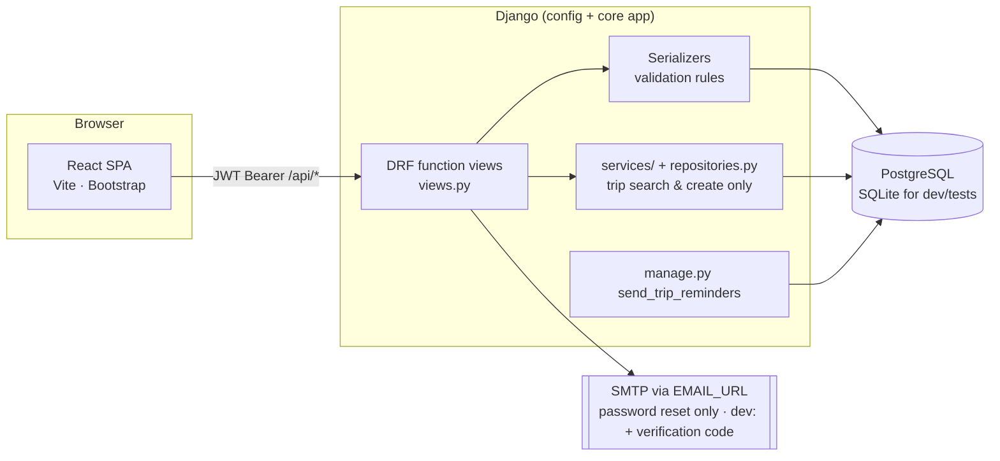
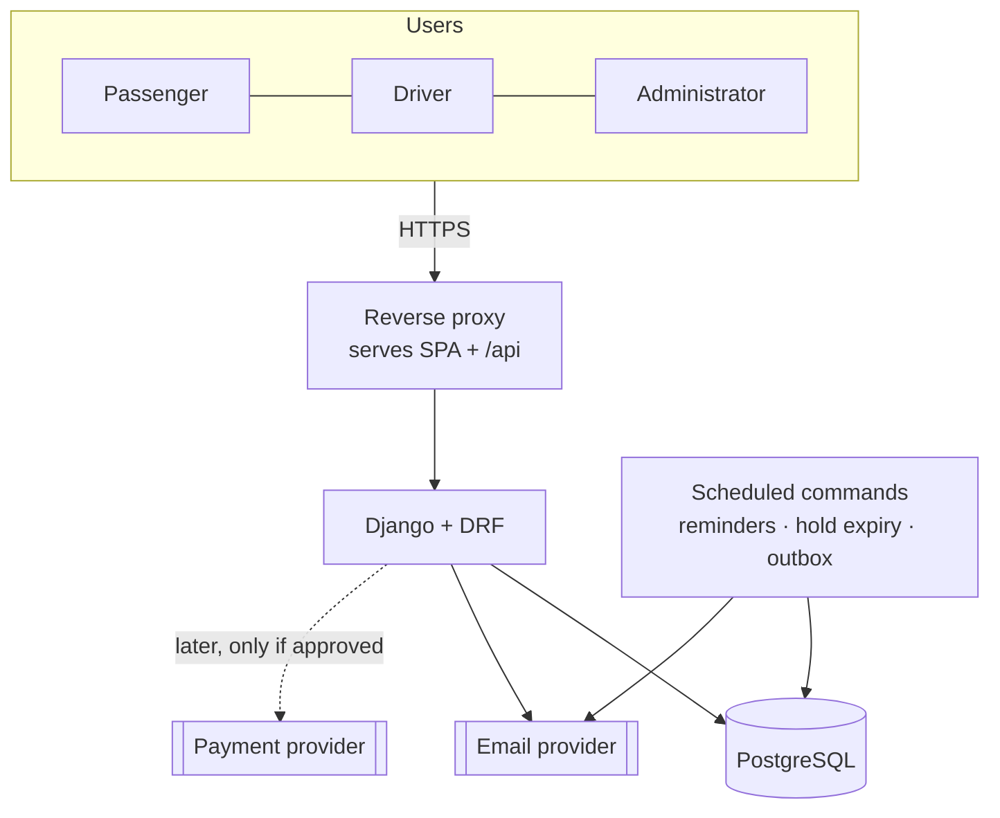
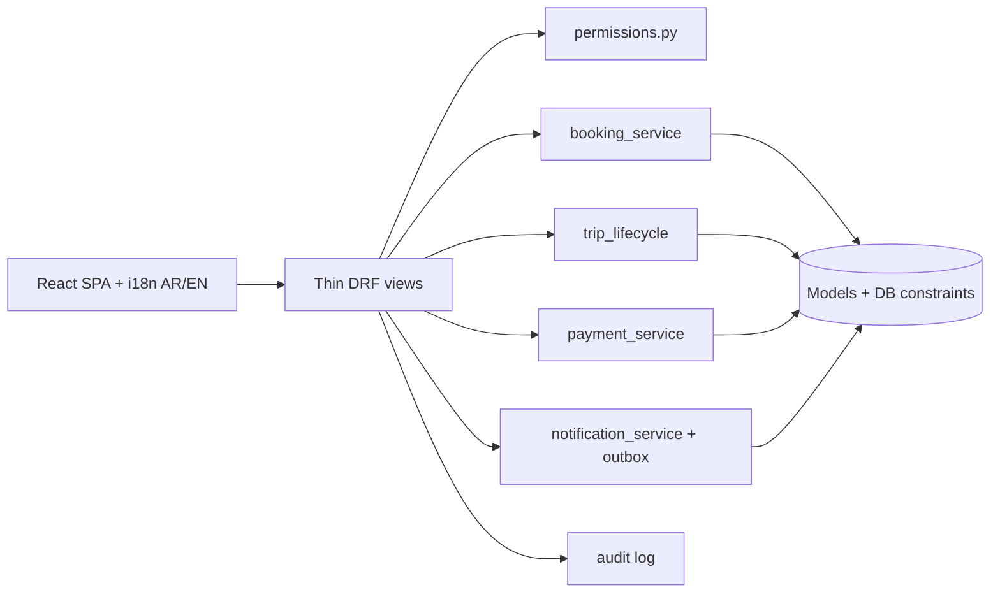
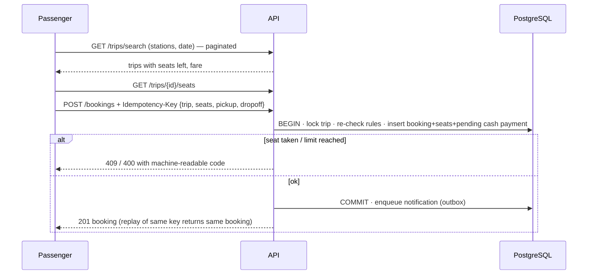
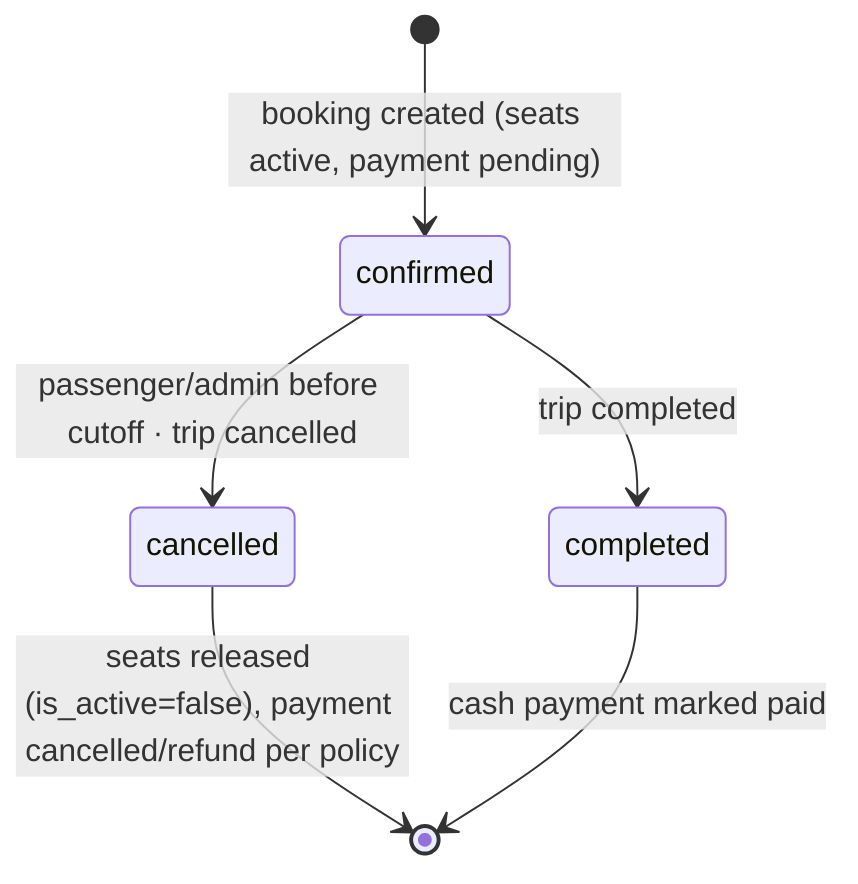
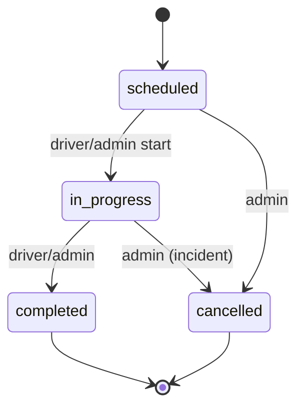
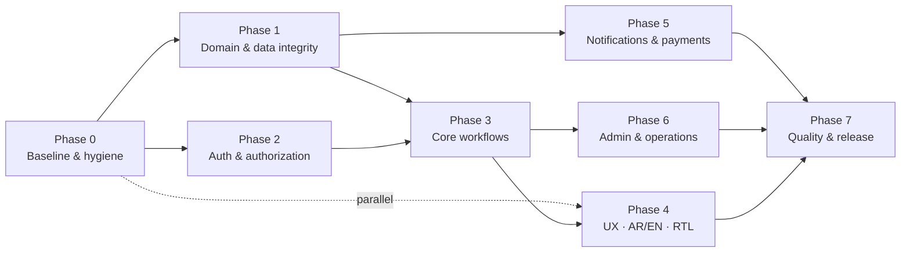

# Wasalni (وصلني) Transportation System — Requirements Audit & Implementation Plan

| Item | Value |
|---|---|
| Repository | `https://github.com/MhmdTalat/transportation-system.git` |
| Default branch | `main` @ `5381816` (merge of PR #1) |
| Newer branch | `dev` @ `fcc3d18` (**1 commit ahead of `main`**, not merged) |
| Audit date | 2026-10-24 |
| Audit method | **Static code review only.** Nothing was executed: no tests, no build, no lint, no migrations, no dependency install. |
| Suggested repo path | `docs/TRANSPORTATION_SYSTEM_REQUIREMENTS_AND_IMPLEMENTATION_PLAN.md` (this file was **not** committed or pushed) |

> **How to read evidence.** `main:path:line` means the line numbers on `main`. Items marked **(dev)** exist only on `dev`. Line numbers on `dev` differ for `views.py` and `settings.py`, so for dev-only items the function/class name is cited instead.
> Status vocabulary: **Implemented** · **Partial** · **Missing** · **Defective** (exists but wrong/insecure) · **Unverified** (could not be confirmed by reading code).

---

## Table of Contents

1. [Executive summary](#1-executive-summary)
2. [Audit scope and limitations](#2-audit-scope-and-limitations)
3. [Verified technology stack](#3-verified-technology-stack)
4. [Repository and architecture overview](#4-repository-and-architecture-overview)
5. [Existing feature inventory](#5-existing-feature-inventory)
6. [Functional requirements](#6-functional-requirements)
7. [Non-functional requirements](#7-non-functional-requirements)
8. [Gap analysis: current vs target](#8-gap-analysis-current-vs-target)
9. [Business rules and unresolved decisions](#9-business-rules-and-unresolved-decisions)
10. [Security and reliability findings](#10-security-and-reliability-findings)
11. [Recommended architecture](#11-recommended-architecture)
12. [Database and API recommendations](#12-database-and-api-recommendations)
13. [UI/UX recommendations](#13-uiux-recommendations)
14. [Testing strategy](#14-testing-strategy)
15. [Prioritized implementation roadmap](#15-prioritized-implementation-roadmap)
16. [Requirement traceability matrix](#16-requirement-traceability-matrix)
17. [Risks, dependencies, rollback](#17-risks-dependencies-and-rollback)
18. [MVP scope and deferred features](#18-mvp-scope-and-deferred-features)
19. [Definition of Done and release checklist](#19-definition-of-done-and-release-checklist)
20. [Sources and evidence](#20-sources-and-evidence)

---

## 1. Executive summary

**What exists.** A working Django + DRF REST API with a React/TypeScript single-page app. It is already a *fixed-route, seat-based booking* system: stations, routes with ordered stops, vehicles with seat layouts, drivers, admin-created trips, seat-level bookings, in-app notifications, password reset and an admin analytics dashboard. It has 51 automated backend tests on `main` (62 on `dev`). The core booking logic is well designed.

**What the code does well (verified):**
- Seat double-booking is prevented by a **database-level partial unique constraint** (`unique_active_trip_seat`, `main:core/models.py:208-212`) plus a row lock on the trip inside a transaction (`main:core/views.py:1051-1060`), with `IntegrityError` mapped to HTTP 409.
- Every admin endpoint calls `_require_admin`; passengers only see their own bookings (`main:views.py:1034-1036, 1133-1137`); drivers only see/modify their own trips and may only *start* or *complete* them (`main:views.py:811-832`).
- Driver/vehicle time-overlap prevention exists with row locking (`main:serializers.py:400-462`, `main:views.py:113-128`).
- Password reset is token-based, throttled, and does not reveal whether an email exists.

**What matters most (highest-impact gaps):**

| # | Finding | Severity | Branch |
|---|---|---|---|
| F-01 | Committed `db.sqlite3` containing a **superuser account**, plus 27 tracked `.pyc` files (29 on dev); `.gitignore` only lists `.env` | High | main + dev |
| F-02 | `Payment` is attached to the **trip**, not the booking, and `main` creates it with status `paid` at trip creation (nothing was paid) | High (main) / Medium (dev: now `pending`) | both |
| F-03 | No token-refresh endpoint and no login throttling on `main` (5-minute default access-token lifetime ⇒ forced re-login) | High | main only; fixed on dev |
| F-04 | Admin can PATCH a trip to *any* status (e.g. revive `cancelled` → `scheduled`); no state machine | Medium | both |
| F-05 | `TIME_ZONE = 'UTC'` while users are in Egypt; date search and reminder text are wrong near midnight | Medium | both |
| F-06 | No pagination anywhere; no intermediate-stop search; fare on trips is not tied to `FareRule` | Medium | both |
| F-07 | No Arabic/English i18n or RTL (only the brand name is Arabic) | Medium (product goal) | both |
| F-08 | No driver verification and no driver trip-publishing flow (admin-only trip creation) | Medium (product goal) | both |
| F-09 | No CI, no frontend tests, no concurrency test, no Docker/`.env.example` | Medium | both |

**Five highest-priority actions**

1. **Baseline and hygiene (Phase 0):** review and merge `dev`; run the existing backend tests and frontend build on PostgreSQL and record results; `git rm --cached` the SQLite DB and `.pyc` files, add a real `.gitignore`, and **reset the committed superuser's password**.
2. **Fix payment semantics (Phase 1):** link payments to bookings, define a payment/booking state machine for cash, stop creating "paid" records at trip creation.
3. **Trip lifecycle + timezone (Phase 1):** enforce allowed status transitions for admins too; set `TIME_ZONE = 'Africa/Cairo'` and fix the date filter.
4. **Booking hardening (Phase 1–3):** idempotency key, per-passenger limits / unpaid-hold expiry, and a PostgreSQL concurrency test.
5. **Close product gaps in order of value (Phase 3–4):** pagination + search, Arabic/English RTL, then driver verification and driver trip publishing (after the business decisions in §9).

**Blocking business questions:** see §9.3 (cancellation/refund policy, driver approval criteria, payment timing, whether drivers publish their own trips, private rides).

---

## 2. Audit scope and limitations

**Inspected:** the full Git tree of `main` and `dev` (140 tracked files on `main`), including `config/settings.py`, `config/urls.py`, `core/models.py`, `core/views.py` (all 1264 lines), `core/serializers.py`, `core/services/*`, `core/repositories.py`, `core/analytics.py`, `core/admin.py`, `core/urls.py`, migrations 0001–0006 (0007–0008 on dev, by diff), `core/tests.py` (test names and key tests), the management command, `requirements.txt`, `frontend/package.json`, `vite.config.ts`, `App.tsx`, `AuthProvider.tsx`, `api.ts`, `resources.ts`, the booking/driver/tracking pages, plus the repo's own `core/requerments/*.md` files. Full diff of `dev` vs `main` for settings, urls, views, models, serializers, repositories, api client and tests.

**Not performed (do not assume these pass):**
- Running backend tests, `manage.py check`, migrations, or the frontend `build`/`lint`.
- Dependency vulnerability scanning (`pip-audit`, `npm audit`).
- Any runtime verification on PostgreSQL (row locks behave differently on SQLite).
- Visual/responsive/accessibility testing in a browser; the `screenshots/` folder on `dev` was not reviewed.
- Reading every frontend component line-by-line (`Dashboard.tsx`, `ResourceForm.tsx`, `UserProfileDetails.tsx` were only grep-checked).
- JWT behavior at runtime: `SIMPLE_JWT` in the repo only sets `CHECK_REVOKE_TOKEN`, so lifetimes are the library defaults. The defaults (access 5 min, refresh 1 day, no rotation) and the existence of `CHECK_REVOKE_TOKEN` were confirmed by reading `djangorestframework-simplejwt 5.5.1` source downloaded to a temp folder (not installed); actual runtime behavior was not executed.

**Secrets handling.** The committed Django `SECRET_KEY` literal, the default DB password and the superuser password hash exist in the repo; **their values are intentionally not reproduced here.**

**Repository documents are not specs.** `core/requerments/*.md` are previous AI prompts (UI design, analytics, Cairo-oriented mobility). They mention features such as private-car booking and live bus tracking that the code does not implement. They were used for context only. There is no Sohag-specific data or seed data in the repo.

---

## 3. Verified technology stack

| Layer | Technology (source) |
|---|---|
| Backend | Django `>=6.1,<6.2`, Django REST Framework `>=3.16,<4`, `djangorestframework-simplejwt >=5.5,<6`, `django-environ`, `psycopg[binary] >=3.2`, `django-cors-headers`, `drf-yasg` (`requirements.txt`) |
| API style | Function-based DRF views (`@api_view`) in a single `core` app; JWT bearer auth (`settings.py:95-98`) |
| Database | PostgreSQL by default (`settings.py:171-188`); SQLite when `USE_SQLITE=true` |
| Cache / email | `CACHE_URL` (default in-memory), `EMAIL_URL` (default console) — production validation rejects both defaults |
| Frontend | React `^19`, TypeScript `~6.0`, Vite `^8`, react-router-dom `^7`, Bootstrap 5.3, recharts (`frontend/package.json`) |
| Frontend tooling | `npm run dev`, `build` (`tsc -b && vite build`), `lint` (oxlint). **No test script.** |
| Dev proxy | Vite proxies `/api`, `/swagger`, `/redoc` to `127.0.0.1:8000` (`vite.config.ts`) |
| Tests | Django `TestCase` in `core/tests.py` (inferred runner: `python manage.py test`) |
| CI/CD, Docker, `.env.example` | **None found** |
| Python dependency locking | Version ranges only; no lock file |

---

## 4. Repository and architecture overview

### 4.1 Meaningful file tree

```
transportation-system/
├── README.md                      (main: title only · dev: production-config notes)
└── transportation_app/
    ├── manage.py · requirements.txt · .gitignore (main: only ".env")
    ├── db.sqlite3                 ⚠ tracked (1 superuser, schema at migration 0001)
    ├── config/        settings.py · urls.py · asgi.py · wsgi.py
    ├── core/
    │   ├── models.py              User, Station, Route, RouteStation, Vehicle, Driver,
    │   │                          FareRule, Trip, Booking, BookingSeat, Payment, Notification
    │   │                          (dev adds EmailVerificationCode)
    │   ├── views.py               1264 lines: HTTP + business logic + notifications
    │   ├── serializers.py         validation incl. trip/vehicle/driver rules
    │   ├── urls.py · admin.py · analytics.py · repositories.py · dependencies.py
    │   ├── services/              trip_service.py · notification_service.py
    │   ├── management/commands/   send_trip_reminders.py
    │   ├── migrations/            0001–0006 (dev: +0007, 0008)
    │   ├── templates/core/emails/ password_reset.html
    │   ├── requerments/           12 prompt/spec-like .md files (not authoritative)
    │   └── tests.py               51 tests (dev: 62)
    └── frontend/
        └── src/
            ├── App.tsx            routes + role guards
            ├── auth/              AuthProvider (token in localStorage)
            ├── services/          api.ts (fetch wrapper) · resources.ts (admin CRUD config)
            ├── pages/             AuthPage, PassengerBookingPage, MyBookingsPage,
            │                      DriverDashboard, Dashboard (analytics), TrackingPage,
            │                      ResourcePage (generic admin CRUD), Notification/Profile/...
            └── components/        AppShell, DataTable, ResourceForm, VehicleSeatMap, RouteMap, ...
```
(Excluded: `__pycache__/`, `node_modules/`, build output, images.)

### 4.2 Current architecture (verified)

A **single-app modular monolith**: SPA → REST/JSON → Django → PostgreSQL. Only trip search/creation uses a service + repository layer (`TripService`, `TripRepository`); booking, cancellation, notifications and trip-lifecycle logic live directly in `views.py`.


*Diagram = verified current behavior.*

### 4.3 Current booking flow (verified, `main:views.py:1045-1128`)

```mermaid
sequenceDiagram
  participant P as Passenger (SPA)
  participant A as POST /api/bookings/
  participant DB as Database
  P->>A: {trip, seat_numbers[1..10]}
  A->>A: role=passenger? validate payload
  A->>DB: BEGIN; SELECT trip FOR UPDATE (+driver, vehicle)
  A->>DB: trip bookable? (published, active route/stations/driver/vehicle, future)
  A->>DB: seats configured? not disabled? not active-booked? capacity ok?
  A->>DB: INSERT booking(confirmed, total=fare×seats); INSERT booking_seat[]
  A->>DB: INSERT notification(booking_confirmation); COMMIT
  A-->>P: 201 booking (or 409 SeatConflict / 400)
```

---

## 5. Existing feature inventory

| Area | Feature | Status | Evidence |
|---|---|---|---|
| Auth | Register passenger/driver (privileged roles rejected) | Implemented | `serializers.py:54-105`; test `test_registration_rejects_privileged_business_roles` |
| Auth | Email verification code before login | Implemented **(dev)** | `verify_email`, `EmailVerifiedTokenObtainPairSerializer` |
| Auth | JWT login | Implemented | `urls.py` `token/` |
| Auth | Token refresh | Missing on main · Implemented **(dev)** | `token/refresh/` route, `api.ts refreshAccessToken` |
| Auth | Login/registration throttling | Missing on main · Implemented **(dev)** | `LoginThrottle`, `RegistrationThrottle` |
| Auth | Logout | Partial — client deletes token only; no server revocation | `AuthProvider.tsx signOut` |
| Auth | Password reset (throttled, generic response, token invalidation via `CHECK_REVOKE_TOKEN`) | Implemented | `views.py:340-403` |
| Auth | Account deactivate/reactivate (passenger/driver) | Implemented | `views.py:429-442` |
| Auth | Driver verification/approval | **Missing** | `serializers.py:103-104` creates active `Driver` instantly |
| Master data | Stations, routes, ordered route stops, vehicles (+seat layout, disabled seats), drivers, fare rules — admin CRUD | Implemented | `views.py:567-749` |
| Trips | Admin create/edit/publish/cancel/delete; draft vs published | Implemented | `views.py:754-854` |
| Trips | Start & complete by assigned driver | Implemented | `views.py:811-832`, `DriverDashboard.tsx` |
| Trips | Driver creates/publishes own trips | **Missing** | `views.py:765` `_require_admin` |
| Trips | Driver/vehicle overlap prevention | Implemented (app level) | `serializers.py:400-462` |
| Trips | Status transition rules for admin | **Missing** | `TripSerializer.validate` has none |
| Search | Passenger trip search by start/destination/date | Partial | `views.py:859-878`; exact endpoints only |
| Search | Route search + fare via `FareRule` (POST) | Implemented but **unused by UI** | `trip_service.py:27-66`; UI calls GET only |
| Booking | Seat-level booking with visual seat map | Implemented | `VehicleSeatMap.tsx`, `views.py:1024-1128` |
| Booking | Cancel before departure; seats released; notification | Implemented | `views.py:1141-1175` |
| Booking | Trip cancel ⇒ bookings cancelled + notified | Implemented | `views.py:942-959` |
| Booking | Pickup/drop-off stop per booking | **Missing** | `Booking` has no stop fields |
| Pricing | `fare_amount` per trip (manual) × seats | Implemented | `views.py:1104` |
| Pricing | `FareRule` fixed / distance / station-count | Implemented, used only by POST search | `models.py:100-135` |
| Payments | Cash/wallet `Payment` rows | **Defective** (trip-level, see F-02) | `models.py:223-237` |
| Notifications | In-app list, mark read, trip reminders (24h/2h) | Implemented | `notification_service.py`, `views.py:1226-1264` |
| Notifications | Email for bookings | **Missing** | only password reset (and dev verification) send email |
| Admin | Analytics dashboard (trips, users; dev: bookings/occupancy) | Implemented | `analytics.py` |
| Admin | Audit log, complaints, driver earnings reports | **Missing** | no models |
| Tracking | "Tracking" page | Partial — static map of trips/routes; **no live GPS/location data model** | `TrackingPage.tsx` |
| i18n | Arabic/English + RTL | **Missing** | `index.html lang="en"`, no i18n library |
| Docs | OpenAPI (`/swagger/`, `/redoc/`) | Implemented (public in all envs) | `config/urls.py:53-82` |

---

## 6. Functional requirements

Columns: **P** = priority (P0 must-fix before safe use · P1 reliable MVP · P2 after MVP · P3 optional). **Status** shows `main / dev` when they differ. **Test** IDs refer to §14.3. Rationale is in brackets in the statement.

### 6.1 Authentication and accounts (FR-AUTH)

| ID | Requirement [rationale] | P | Status | Evidence | Acceptance criteria | Test |
|---|---|---|---|---|---|---|
| FR-AUTH-001 | Registration must verify email ownership before first login [prevents fake/mistyped accounts that receive notifications] | P1 | Missing / Implemented | dev `verify_email`, `EmailVerificationCode` | Login before verification → 401 `email_not_verified`; correct 6-digit code verifies; code expires (default 600 s) and locks after 5 failures | T-AUTH-04 |
| FR-AUTH-002 | Login, registration and code endpoints must be rate-limited [credential stuffing] | P0 | Missing / Implemented | dev `LoginThrottle` 5/min | 6th login attempt in 1 min from one client → 429 | T-AUTH-01 |
| FR-AUTH-003 | Sessions must survive beyond the access-token lifetime via refresh [main logs users out ~every 5 min] | P0 | Defective / Implemented (unverified at runtime) | main `urls.py` has only `token/`; dev `token/refresh/` + `api.ts` | Expired access token → one refresh call → original request retried; invalid refresh → user returned to login | T-AUTH-02 |
| FR-AUTH-004 | Logout must revoke the refresh token server-side [stolen refresh token stays valid for its lifetime] | P1 | Missing | no `token_blacklist` app, no logout route | After logout, refresh with old token → 401 | T-AUTH-03 |
| FR-AUTH-005 | Password reset must stay generic, throttled, single-use, and invalidate old JWTs | P1 | Implemented | `views.py:340-403`; tests `PasswordResetApiTests` | Existing tests pass; old access token rejected after reset | T-AUTH-05 |
| FR-AUTH-006 | Role checks must be centralised in DRF permission classes [today: ad-hoc helper calls in every view; easy to forget] | P1 | Partial | `_require_admin/_require_role` in `views.py:97-110` | Every non-public route has an explicit permission class; a test enumerates all URL patterns and asserts an anonymous request is 401 except an allow-list | T-AUTH-06 |
| FR-AUTH-007 | Admin can deactivate/reactivate passenger and driver accounts; deactivated users cannot authenticate | P1 | Implemented | `views.py:429-442`, tests | Deactivated user's login and existing token both rejected | T-AUTH-07 |
| FR-AUTH-008 | Drivers must be approved by an admin (documents + vehicle) before they can be assigned or publish trips [safety of passengers] | P1 | Missing | `serializers.py:103-104` | New driver has `verification_status=pending`; assignment/publish rejects non-`approved` drivers; approval/rejection recorded with admin + timestamp | T-AUTH-08 |
| FR-AUTH-009 | Email must be unique case-insensitively **at the database level** [serializer check at `serializers.py:80-84` is racy; `AbstractUser.email` is not unique] | P1 | Partial | `models.py:6-24` | Two concurrent registrations with `A@x.com` / `a@x.com` → exactly one succeeds | T-DB-02 |

### 6.2 Trip management (FR-TRIP)

| ID | Requirement | P | Status | Evidence | Acceptance criteria | Test |
|---|---|---|---|---|---|---|
| FR-TRIP-001 | Admin can create, edit, publish, cancel trips with route, ordered start/destination stops, vehicle, driver, times, fare | P1 | Implemented | `views.py:754-854` | Existing tests pass; publish requires all fields and a future departure | T-TRIP-01 |
| FR-TRIP-002 | Trip status changes must follow a state machine for **all** roles: `scheduled→in_progress→completed`, `scheduled→cancelled`, `in_progress→cancelled` (admin only). No other transitions [today an admin can revive `cancelled`/`completed` trips] | P1 | Defective | `serializers.py:290-398` has no transition check; driver-only check at `views.py:818-832` | `cancelled→scheduled` and `completed→*` return 400; each legal transition has a test | T-TRIP-02 |
| FR-TRIP-003 | A driver or vehicle cannot be on two overlapping active trips | P0 | Implemented (app level) | `serializers.py:400-462`, `views.py:113-128` | Existing tests pass; concurrent create of two overlapping trips → one 400 | T-TRIP-03, T-DB-03 |
| FR-TRIP-004 | Date search must use the operating time zone (`Africa/Cairo`) [`departure_time__date` runs in UTC at `views.py:877`] | P1 | Defective | `settings.py:215` `TIME_ZONE='UTC'` | A trip departing 00:30 Cairo time is returned for that Cairo date and not for the previous day | T-TRIP-04 |
| FR-TRIP-005 | Search may match intermediate stops (board/alight at any stop of a route, in order) [routes already store ordered stops; search ignores them] | P2 | Missing | `views.py:866-869` exact-station filter | Trip A→B→C is found for a B→C search; price reflects segment | T-TRIP-05 |
| FR-TRIP-006 | `Trip.fare_amount` must be derived from, or validated against, the active `FareRule` [two unrelated fare sources today] | P1 | Partial | `FareRule` used only in `trip_service.py:53-58` | Creating a trip with no fare uses the rule; an out-of-policy fare requires an explicit admin override flag | T-TRIP-06 |
| FR-TRIP-007 | All list endpoints must be paginated, filterable and sortable [none are; `users`, `trips`, `bookings`, `notifications` return everything] | P1 | Missing | no pagination settings; `views.py` returns full querysets | `?page_size` capped at 100; response includes `count/next/previous/results`; 10k-row fixture stays within NFR-PERF-001 | T-API-01 |
| FR-TRIP-008 | Drivers may create **draft** trips for admin approval (or publish directly — see OBD-03) | P2 | Missing | `views.py:765` | Approved driver with assigned vehicle can POST a draft; cannot publish unless policy allows | T-TRIP-07 |
| FR-TRIP-009 | Private-car rides are a **separate workflow** (request → driver accepts → ride), not a `Trip` type [see §9.2] | P3 | Missing | — | Deferred; no acceptance criteria until OBD-01 is decided | — |

### 6.3 Booking and seat allocation (FR-BOOK)

| ID | Requirement | P | Status | Evidence | Acceptance criteria | Test |
|---|---|---|---|---|---|---|
| FR-BOOK-001 | A seat on a trip can have at most one active booking | P0 | Implemented | `models.py:208-212` partial unique; `views.py:1081-1091, 1122-1125` | N parallel requests for the same seat → exactly 1×201, rest 409; DB holds 1 active row | T-BOOK-01 |
| FR-BOOK-002 | Bookings cannot exceed vehicle capacity minus disabled seats; only configured seats can be booked | P0 | Implemented | `views.py:1066-1099` | Existing tests pass | T-BOOK-02 |
| FR-BOOK-003 | Booking creation must be idempotent via a client-supplied `Idempotency-Key` [double-click with different seats creates two bookings today] | P1 | Partial | `BookingCreateSerializer` (`serializers.py:510-521`) has no key | Same key + same payload → same booking returned (200/201); same key + different payload → 422 | T-BOOK-03 |
| FR-BOOK-004 | Cancellation window and fee rules must be configurable and enforced server-side [today: any time before departure] | P1 | Partial | `views.py:1158-1165` | Cancel after the configured cutoff → 400 with reason; config change needs no deploy | T-BOOK-04 |
| FR-BOOK-005 | Seat-hoarding controls: max active upcoming bookings per passenger; unpaid/unconfirmed holds expire [bookings auto-confirm with no payment] | P1 | Missing | `views.py:1101-1113` | 11th active booking rejected (limit proposed: 5, **requires decision**); expired holds release seats automatically | T-BOOK-05 |
| FR-BOOK-006 | Passengers see only their own bookings; admins see all; drivers none | P0 | Implemented | `views.py:1026-1043, 1133-1138`; test `test_passengers_cannot_create_trips_or_read_other_passengers_bookings` | Existing tests pass | T-BOOK-06 |
| FR-BOOK-007 | Booking records pickup and drop-off stops [needed for multi-stop routes] | P2 | Missing | `models.py:168-192` | Booking requires valid stops in route order; fare reflects segment | T-BOOK-07 |
| FR-BOOK-008 | Driver sees passenger name/phone only for their own trip and only within a configurable window before departure [privacy] | P2 | Partial | `views.py:1180-1203` exposes phone at any time | Outside window → phone masked | T-BOOK-08 |
| FR-BOOK-009 | Cancelling or completing a trip updates all bookings/seats atomically | P0 | Implemented | `views.py:942-966` | Existing tests pass; failure mid-way rolls back | T-BOOK-09 |

### 6.4 Pricing and payments (FR-PAY)

> Do **not** integrate a real payment provider until FR-PAY-001 and FR-PAY-002 are done.

| ID | Requirement | P | Status | Evidence | Acceptance criteria | Test |
|---|---|---|---|---|---|---|
| FR-PAY-001 | A payment belongs to a **booking** (not a trip); no payment is created at trip creation | P0 | Defective | `models.py:223-237` (FK to `Trip`); `repositories.py:55-61` creates it; main default status `paid` (`models.py:232`); dev default `pending` but still trip-level | Creating a trip creates 0 payments; booking creates a `pending` cash payment linked to it; existing trip-level rows migrated to `legacy` | T-PAY-01 |
| FR-PAY-002 | Payment statuses are a closed set with allowed transitions: `pending→paid`, `pending→failed`, `pending→cancelled`, `paid→refunded` | P1 | Missing | `status` is free text | Illegal transition → 400; booking cancel on `pending` payment cancels it | T-PAY-02 |
| FR-PAY-003 | Online payments need webhook signature verification, idempotent processing and reconciliation | P2 (deferred) | Missing | — | Defined after OBD-04 | T-PAY-03 |
| FR-PAY-004 | Refund workflow | P3 (deferred) | Missing | — | Needs OBD-02 | — |
| FR-PAY-005 | Totals shown to passengers are computed server-side only | P0 | Implemented | `views.py:1104` | Client cannot supply amount | T-PAY-04 |

### 6.5 Notifications (FR-NOTIF)

| ID | Requirement | P | Status | Evidence | Acceptance criteria | Test |
|---|---|---|---|---|---|---|
| FR-NOTIF-001 | In-app notifications for booking, cancellation, trip changes | P1 | Implemented | `views.py:909-966` | Existing behavior retained | T-NOTIF-01 |
| FR-NOTIF-002 | Reminders must be generated by a scheduled job, not as a side effect of `GET` requests [`create_due_trip_reminders` runs inside `GET /bookings` and `GET /notifications`, `views.py:1035, 1229`] | P1 | Partial | command exists: `send_trip_reminders.py` | GET endpoints perform no writes; scheduler (cron/systemd timer) runs the command every 10 min; no duplicates | T-NOTIF-02 |
| FR-NOTIF-003 | Email for booking confirmation/cancellation through an outbox with retry and failure logging | P2 | Missing | — | Provider failure leaves outbox row `failed` with attempts; retry succeeds; booking is unaffected | T-NOTIF-03 |
| FR-NOTIF-004 | Reminder text must show the Cairo local time | P1 | Defective | `notification_service.py:103` formats `localtime` = UTC | Message shows Cairo time | T-NOTIF-04 |

### 6.6 Administration and operations (FR-ADMIN)

| ID | Requirement | P | Status | Evidence | Acceptance criteria | Test |
|---|---|---|---|---|---|---|
| FR-ADMIN-001 | Admin CRUD for users, stations, routes, stops, vehicles, drivers, fare rules, trips | P1 | Implemented | `views.py:567-749` | Existing tests pass | T-ADMIN-01 |
| FR-ADMIN-002 | Deleting stations/routes must not silently delete trips [`on_delete=CASCADE` on `Trip.route/start_station/destination_station`; only bookings `PROTECT`] | P1 | Partial | `models.py:137-165` | Delete blocked while any non-cancelled trip references it; use `is_active`/archive instead | T-ADMIN-02 |
| FR-ADMIN-003 | Audit log of admin mutations (who, what, before/after, when, IP) | P2 | Missing | — | Every POST/PATCH/DELETE on admin resources writes a row; rows are append-only | T-ADMIN-03 |
| FR-ADMIN-004 | Complaint intake (passenger/driver) and admin handling | P2 | Missing | — | Create/list/assign/resolve with status history | T-ADMIN-04 |
| FR-ADMIN-005 | Booking and revenue reports | P2 | Partial (dev adds booking analytics) | `analytics.py` | Report totals equal SQL ground truth on a fixture | T-ADMIN-05 |
| FR-ADMIN-006 | Django `/admin/` user editing must hash passwords (use `UserAdmin`) | P2 | Defective | `admin.py:152-154` plain `ModelAdmin` | Editing a user cannot store a raw password | T-ADMIN-06 |
| FR-ADMIN-007 | `authority` role semantics [treated as full admin today, `views.py:97-98`] must be defined or removed | P2 | Partial | `models.py:9-14` | Documented permission matrix; tests per role | T-AUTH-06 |

---

## 7. Non-functional requirements

Numeric targets below are **proposed targets requiring validation** with real traffic expectations.

| ID | Requirement | P | Status | Evidence | Acceptance criteria | Test |
|---|---|---|---|---|---|---|
| NFR-SEC-001 | No secrets or databases in Git; history cleaned; superuser credential reset | P0 | Defective | `db.sqlite3` and 27 `.pyc` tracked (29 on dev); `.gitignore` = `.env` (main); hard-coded key literal `settings.py:25` (overridden at `:57`; removed on dev) | `git ls-files` contains no `*.sqlite3`, `*.pyc`, `.env`; CI secret scan passes; default DB credentials removed from `settings.py:38-44` | T-SEC-01 |
| NFR-SEC-002 | App refuses to start in production with unsafe settings | P0 | Implemented (dev) | dev `_validate_production_configuration`, test `ProductionSettingsTests` | Starting with `DEBUG=False` and `ALLOWED_HOSTS=*` fails | T-SEC-02 |
| NFR-SEC-003 | Throttling behind a reverse proxy uses the real client IP (`NUM_PROXIES` / trusted proxy config) and a shared cache | P1 | Unverified | dev throttles use `AnonRateThrottle` (IP-keyed) | Two clients behind the proxy are throttled independently | T-SEC-03 |
| NFR-SEC-004 | API docs not publicly exposed in production | P2 | Defective | `config/urls.py:53-82` `public=True`, `AllowAny` | `/swagger/` requires admin or is disabled when `DEBUG=False` | T-SEC-04 |
| NFR-SEC-005 | Token storage reviewed: rotate+blacklist refresh tokens; evaluate httpOnly cookies | P2 | Partial | tokens in `localStorage` (`AuthProvider.tsx`); dev stores refresh there too | Refresh rotation on; XSS review documented | T-SEC-05 |
| NFR-SEC-006 | Cross-origin policy explicit: either same-origin deployment (documented) or CORS configured [`corsheaders` is installed but **not in `MIDDLEWARE` and has no settings**, `settings.py:85, 138-146`] | P1 | Defective/Unverified | as cited | Production topology documented; a cross-origin request behaves as designed | T-SEC-06 |
| NFR-PERF-001 | *Proposed:* p95 ≤ 500 ms for trip search and p95 ≤ 800 ms for booking at 50 concurrent users on 10k trips / 200k bookings | P2 | Unverified | `_bookable_trips` loads candidate rows into Python (`views.py:158-168`) | Load test meets targets on staging | T-PERF-01 |
| NFR-PERF-002 | Query counts do not grow with row count on list endpoints | P2 | Partial | tests for trips/analytics exist | Add for bookings, notifications, users | T-PERF-02 |
| NFR-REL-001 | All timestamps stored UTC, displayed in `Africa/Cairo` | P1 | Defective | `settings.py:215` | See FR-TRIP-004 | T-TRIP-04 |
| NFR-REL-002 | CI runs tests/lint/build on every PR with a PostgreSQL service | P1 | Missing | no `.github/` | PR cannot merge on red | T-CI-01 |
| NFR-REL-003 | Structured logging, error tracking, health endpoint, DB backups with a tested restore | P2 | Missing | no `LOGGING` in settings | `/healthz` returns DB status; restore drill documented | T-OPS-01 |
| NFR-REL-004 | Reproducible Python dependencies (lock file) | P2 | Missing | ranges only | Locked install yields identical versions | T-CI-01 |
| NFR-UX-001 | Arabic and English UI with full RTL layout; language persisted; Arabic numerals/dates optional | P1 | Missing | `index.html lang="en"`; no i18n | Switching to Arabic sets `dir="rtl"`, all strings translated, no mirrored-icon or overflow defects on 360 px width | T-UX-01 |
| NFR-UX-002 | WCAG 2.1 AA baseline for passenger flows (labels, focus, contrast, keyboard seat selection) | P2 | Unverified | 162 `aria-*`, 11 `htmlFor`, 1 `alt` found | axe scan: 0 serious/critical on search/booking/login | T-UX-02 |
| NFR-UX-003 | Every data view has loading, empty, error and success states | P2 | Unverified (several pages show them) | grep of pages | Checklist per page passes | T-UX-03 |
| NFR-MAINT-001 | `views.py` split by domain; booking/trip logic in services | P2 | Partial | `views.py` 1264 lines | No view function >40 lines of logic; behavior-preserving (all existing tests green) | T-REG-01 |
| NFR-TEST-001 | Critical business rules have automated tests incl. concurrency on PostgreSQL | P1 | Partial | no concurrency test (`grep` for threads: none) | See §14 | T-BOOK-01 |

---

## 8. Gap analysis: current vs target

| Product goal (from brief) | Current state | Gap | Plan |
|---|---|---|---|
| Passenger registers/signs in | Works; dev adds email verification | Main lacks refresh/throttle | Phase 0 (merge dev) |
| Enter start/destination, search trips | Works for exact start/destination + date | Time-zone bug, no pagination, no intermediate stops | Phases 1, 3 |
| View seats, fare, pickup/drop-off | Seat map and fare ✔; pickup/drop-off per booking ✘ | Booking stops | Phase 3 (P2) |
| Book a seat, confirmation + notifications | In-app ✔; email ✘ | Email outbox | Phase 5 |
| Cancel per rules; history | Cancel before departure ✔ | Configurable policy | Phase 3 |
| Driver registers + verification | Registers instantly; no verification | Verification model/workflow | Phase 2 |
| Driver creates/publishes trips | Admin only | Driver self-service (needs OBD-03) | Phase 3 (P2) |
| Driver confirms/rejects requests | Instant auto-confirm; no request flow | Decision OBD-05 | Deferred |
| Prevent overbooking/conflicts | ✔ (app + DB for seats) | Concurrency test, DB-level overlap constraint | Phases 1, 7 |
| Driver trip history/earnings | Trip list ✔; earnings ✘ | Needs payments | Phase 6 (P3) |
| Admin manages users/vehicles/trips | ✔ | Pagination, audit, complaints | Phases 3, 6 |
| Arabic/English + RTL | ✘ | Full i18n | Phase 4 |
| Private rides | ✘ | Separate workflow | Deferred (P3) |

---

## 9. Business rules and unresolved decisions

### 9.1 Rule enforcement check (the 13 scenarios)

| # | Scenario | main | dev | Evidence / note |
|---|---|---|---|---|
| 1 | Origin and destination valid and different; stops in route order | Implemented | same | `serializers.py:315-338`, `TripSearchSerializer`; test `…rejects_identical_start_and_destination…`. App-level only (no DB check) |
| 2 | Cannot exceed capacity | Implemented | same | `views.py:1092-1099` |
| 3 | Same seat cannot be reserved twice | Implemented | same | partial unique constraint `models.py:208-212` |
| 4 | Concurrent requests don't overbook | Implemented by design; **Unverified** (no concurrency test; SQLite ignores row locks, the unique constraint still protects seats) | same | `views.py:1051-1060, 1122-1125` |
| 5 | Only authorised drivers manage their trips | Implemented | same | `views.py:811-832, 1180-1190` |
| 6 | Driver/vehicle cannot overlap | Implemented (app level) | same | `serializers.py:400-462`. Gaps: drafts without times skip the check until published; no DB exclusion constraint |
| 7 | Passenger cannot read others' bookings | Implemented | same | `views.py:1133-1137`; notifications filtered `1243-1246` |
| 8 | Cancelled trip accepts no bookings | Implemented — but admin can revive it (F-04) | same | `_bookable_trips` status filter `views.py:153-157` |
| 9 | Cancellation updates seats/state consistently | Implemented | same | `views.py:1166-1168, 942-959` (payment side not covered) |
| 10 | Payment failure never marks booking paid | **Not applicable / Defective**: no booking payment flow; main records trip-level `paid` | Partial (`pending`) | F-02 |
| 11 | Duplicate requests don't duplicate bookings/charges | Partial: same seats ⇒ 409; different seats ⇒ 2 bookings; no idempotency key | same | FR-BOOK-003 |
| 12 | Invalid/past departure rules | Partial: publish requires future departure for `scheduled`; no guard on editing past trips; **dev** forbids deleting trips before departure | same | `serializers.py:365-368`; dev `trip_detail` DELETE |
| 13 | Non-admins cannot use admin operations | Implemented (every admin view calls `_require_admin`) | same | verified by reading all views |

### 9.2 Fixed-route trips vs private rides — recommendation

The current model is **fixed-route, scheduled, seat-based** (`Route` → `RouteStation` → `Trip` → `Booking` → `BookingSeat`). A private ride is a different product: no seats, on-demand, pricing by distance/time, a driver accepts, and live location matters. Forcing it into `Trip` would add nullable fields and special cases to every booking rule. **Recommendation:** keep `Trip` for fixed routes (microbus and shared car), and, if/when approved, add a separate `RideRequest` workflow (request → offered/accepted → in progress → completed) reusing `Driver`, `Vehicle`, `Station`/coordinates and `Notification`. It is not needed for the MVP.

### 9.3 Open business decisions (not established policy — nothing below is assumed in this plan)

| ID | Decision needed | Why it blocks | Suggested default to discuss |
|---|---|---|---|
| OBD-01 | Are private rides in scope, and when? | FR-TRIP-009 | Out of MVP |
| OBD-02 | Cancellation cutoff, fees, refund eligibility | FR-BOOK-004, FR-PAY-004 | Free until X hours before departure (X to be set) |
| OBD-03 | Do drivers publish trips themselves, or does an admin approve each trip? | FR-TRIP-008 | Draft by driver → admin publishes |
| OBD-04 | Payment model: cash on board only, or online (which provider, wallet?) | FR-PAY-003 | Cash only for MVP |
| OBD-05 | Booking confirmation: instant (current) or driver confirms/rejects | Driver journey | Keep instant for fixed routes |
| OBD-06 | Driver approval criteria and required documents (licence, vehicle licence, etc.) | FR-AUTH-008 | Admin review of uploaded documents |
| OBD-07 | May passengers book a trip already `in_progress` (current behavior, tested) | `views.py:154-155` | Probably no, or only before an X-minute grace |
| OBD-08 | Can admins delete future unbooked trips (main yes; dev **no**, tested) | Operational convenience vs audit | Allow delete for drafts; cancel for published |
| OBD-09 | Max active bookings per passenger; hold expiry | FR-BOOK-005 | Set after pilot data |
| OBD-10 | Meaning of the `authority` role vs `admin` | FR-ADMIN-007 | Read-only reporting role |
| OBD-11 | When may drivers see passenger phone numbers | FR-BOOK-008 | From 2 h before departure |
| OBD-12 | Languages beyond Arabic/English; Arabic-Indic numerals? | NFR-UX-001 | Western digits by default |
| OBD-13 | Sohag master data (stations, routes, fares) source and owner | Seed data does not exist | Admin enters; ship a seed fixture |

---

## 10. Security and reliability findings

Severity reflects impact *if the finding is real in the deployed environment*. Each was traced through code; where a control could exist outside the repo this is noted.

### F-01 — Database and bytecode committed; superuser credential in Git — **High** (main + dev)
- **Evidence:** `git ls-files` lists `transportation_app/db.sqlite3` and 27 `__pycache__/*.pyc` (29 on dev); `.gitignore` on main contains only `.env`. A read-only query shows one user: `is_superuser=1`, `is_staff=1`, role `passenger`; only migration `0001` of `core` is recorded (stale schema).
- **Impact:** an offline-crackable password hash for a privileged account is public in history; stale DB invites accidental reuse.
- **Remediation:** `git rm --cached` both; extend `.gitignore` (`*.sqlite3`, `__pycache__/`, `.env*`, `node_modules/`, `dist/`); reset that account's password anywhere it was reused; consider history rewrite (`git filter-repo`) if the repo is or becomes public; add a CI secret/artifact check.
- **Tests:** T-SEC-01.

### F-02 — Payment modelled per trip and created as `paid` — **High** (main) / **Medium** (dev)
- **Evidence:** `Payment.trip` FK (`models.py:224`); `create_trip_with_payment` inserts a cash payment on every trip creation (`repositories.py:55-61`); default status `paid` on main (`models.py:232`); dev changes the default to `pending` (migration `0007_alter_payment_status`) but remains trip-level. `Booking` has no payment relation. `PaymentSerializer` is `__all__`, so an admin can write arbitrary statuses.
- **Impact:** financial data would be wrong; any revenue report built on `Payment` is meaningless; unsafe foundation for online payments.
- **Remediation:** FR-PAY-001/002 (Phase 1).

### F-03 — Session handling and brute force on `main` — **High** (main) / **Resolved** (dev, unverified at runtime)
- **Evidence:** main `core/urls.py` has `token/` only (no refresh) and no throttle on login/registration (`settings.py:99-102` lists only password-reset scopes); frontend stores one access token (`AuthProvider.tsx`). dev adds `token/refresh/`, `LoginThrottle` (5/min), `RegistrationThrottle` (5/h), email-verification throttles and the refresh retry in `api.ts`.
- **Residual (dev):** refresh token in `localStorage`; no blacklist/rotation (`token_blacklist` not installed; defaults not overridden); IP-keyed throttle needs proxy configuration (NFR-SEC-003).

### F-04 — No trip state machine for admin edits — **Medium**
- **Evidence:** `TripSerializer` is `fields='__all__'` with writable `status` and `is_published` (`serializers.py:285-288`); `validate` (`:290-398`) never compares old and new status. Only the driver path restricts transitions (`views.py:818-832`).
- **Impact:** a cancelled trip (bookings already cancelled and notified) can be set to `scheduled` and become bookable again; a `completed` trip can be re-opened; un-publishing a trip with confirmed bookings is not blocked.
- **Remediation:** FR-TRIP-002 with a `TripLifecycleService` (Phase 1).

### F-05 — Time zone — **Medium**
- **Evidence:** `TIME_ZONE='UTC'` (`settings.py:215`); date filter `departure_time__date=travel_date` (`views.py:877`) evaluates in the active zone (UTC); reminder text uses `timezone.localtime` (`notification_service.py:103`) which is UTC. The browser formats dates in the user's zone (`Intl.DateTimeFormat(undefined…)`), so UI and API can disagree.
- **Impact:** early-morning Cairo departures are filtered under the wrong date; reminder times are off by the UTC offset.
- **Remediation:** set `TIME_ZONE='Africa/Cairo'` (storage stays UTC because `USE_TZ=True`), compute search day ranges explicitly, test around midnight and DST (Egypt observes DST — verify current rules when writing the test).

### F-06 — Scalability and API contract — **Medium**
- No pagination on any list; `_bookable_trips` fetches `values_list` rows into Python then re-filters by `pk__in` (`views.py:158-168`); per-request reminder generation inside GET handlers (`views.py:1035, 1229`); search endpoint returns full serialized trips including a nested `payment` object to passengers (`TripSerializer.get_payment`).
- Search ignores intermediate stops; the richer POST route search with fare rules (`views.py:880-901`) is not used by the UI.

### F-07 — Seat hoarding and duplicate submissions — **Medium**
- Bookings are confirmed immediately (`views.py:1101-1113`), there is no per-user limit (only `max_length=10` seats per request, `serializers.py:512-516`), no hold expiry, no idempotency key. A user can lock many trips for free.

### F-08 — Deployment-readiness gaps — **Medium**
- `corsheaders` installed but unused (`settings.py:85`, absent from `MIDDLEWARE` `:138-146`); works only through the Vite proxy or a same-origin reverse proxy.
- Default DB credentials in code (`settings.py:38-44`) — weak numeric password and non-standard port default (values not repeated here).
- On main: `ALLOWED_HOSTS` default `['*']` (`settings.py:61-64`), no HTTPS/HSTS/secure-cookie settings; **dev fixes** these via production validation.
- `/swagger/` and `/redoc/` public regardless of environment; `/` redirects to `/admin/`.
- No `LOGGING`, no error tracking, no health endpoint, no Docker/CI/`.env.example`; README on main is a single title line.

### F-09 — Data-integrity gaps in the schema — **Medium**
- Free-text `status` on `Route`, `Vehicle`, `Driver`, `Payment` (no `choices`); code compares `route.status.strip().casefold()` (`serializers.py:359`) and `iexact` (`views.py:147`), indicating inconsistent data already.
- No DB `CHECK` constraints (arrival > departure, fare ≥ 0, capacity ≥ 1 — `PositiveIntegerField` allows 0); `RouteStation` lacks `UNIQUE(route, sequence_order)`; email not DB-unique; cascade deletes from `Station`/`Route` to `Trip` (`models.py:137-165`).
- Indexes exist only on `Trip.created_at` and two `User` columns (migration 0006); common filters (`trip.status/departure_time/driver/vehicle`, `booking.passenger/status`, `notification.user/is_read`) rely on single-column FK indexes.
- `POST /api/drivers/` appears unusable: `DriverSerializer.user` is read-only (`serializers.py:223`) so creation would omit the required `user` — **Unverified** (static trace suggests an `IntegrityError`; the UI sets `canCreate: false`, `resources.ts`).

### F-10 — Lower-severity items
| ID | Severity | Item | Evidence |
|---|---|---|---|
| F-10a | Low | Registration reveals whether an email/username exists | `serializers.py:80-84` |
| F-10b | Low | Django admin edits `User` with plain `ModelAdmin` (raw password field) | `admin.py:152-154` |
| F-10c | Low | Tokens in `localStorage` (XSS exposure) | `AuthProvider.tsx` |
| F-10d | Low | Driver sees passenger phone numbers for all confirmed bookings regardless of timing | `views.py:1195-1197` |
| F-10e | Low | `get_or_create` reminder race may raise `IntegrityError` under parallel GETs (unique `dedupe_key`) | `notification_service.py:107-116` |
| F-10f | Low | `drf-yasg` is a maintenance-mode library (verify before relying on it long-term) | `requirements.txt` |
| F-10g | Info | "Tracking" page is not live tracking; no location data model | `TrackingPage.tsx` |
| F-10h | Info | Python deps unpinned ranges; dependency vulnerabilities **not assessed** | `requirements.txt` |

---

## 11. Recommended architecture

**Keep the modular monolith (Django + DRF + React SPA + PostgreSQL).** Evidence shows the working core is sound; the requirements (one city, scheduled routes, seat booking) do not justify microservices, event buses or a rewrite. Targeted changes only:

1. **Introduce a real service layer for the risky flows** (booking, cancellation, trip lifecycle, payment) in `core/services/` and make views thin. Today only trip search/creation is layered (`TripService`/`TripRepository`) while the most critical code is inline in `views.py`. Do **not** add more repository abstraction; Django ORM calls inside services are enough.
2. **Central permissions** in `core/permissions.py` (new) replacing ad-hoc `_require_*` calls.
3. **Split `views.py`** (1264 lines) into a `core/views/` package by domain *after* tests protect behavior (Phase 6).
4. **Background work without new infrastructure first:** management commands run by cron/systemd timer (reminders, hold expiry, outbox sender). Add Celery/Redis only if volume or latency demands it.
5. **PostgreSQL is the production database**; SQLite stays for quick local runs only, because row locks and partial/exclusion constraints behave differently.
6. **Same-origin deployment** (reverse proxy serving the SPA and `/api`) to avoid CORS and keep the Vite-proxy model.


*Proposed system context.*


*Proposed components (labels = new modules, except `notification_service` which exists).*

### 11.1 Proposed passenger booking workflow



### 11.2 Proposed booking / seat / payment lifecycle




*Both diagrams are **proposed** rules; the current code allows any admin-set transition (F-04). A future `pending`/`expired` booking status is only needed if holds are introduced (OBD-09).*

---

## 12. Database and API recommendations

### 12.1 Existing entities (verified)

`User(role)` · `Station` · `Route` · `RouteStation(route, station, sequence_order; UNIQUE route+station)` · `Vehicle(capacity, seat_layout JSON, disabled_seats JSON)` · `Driver(1:1 user, 1:1 vehicle)` · `FareRule` · `Trip(route, vehicle, driver, start/destination, times, status, is_published, fare_amount)` · `Booking(passenger PROTECT, trip PROTECT, status, total_amount)` · `BookingSeat(booking, trip, seat_number, is_active; partial UNIQUE trip+seat where active)` · `Payment(trip, amount, method, status)` · `Notification(user, booking, dedupe_key UNIQUE)`.

**Seats are explicit rows** (`BookingSeat`), not just a count — good: it allows seat-level selection, unique enforcement and release on cancel. Implication: layout/disabled seats live as JSON on `Vehicle`, so layout changes must be validated against active bookings (already done: `serializers.py:192-218`). Capacity is derived from the vehicle, so a trip's seat count changes if its vehicle is swapped (guarded at `serializers.py:370-394`).

### 12.2 Recommended schema changes (all **proposed**; migration numbers follow dev's 0007–0008)

| # | Change | Why | Migration risk / order |
|---|---|---|---|
| D1 | `Payment.booking` FK (nullable→required after backfill); `Payment.status` choices; `idempotency_key`; keep `trip` FK nullable & deprecated; mark old rows `legacy` | FR-PAY-001/002 | Expand → backfill → contract in 2 releases; reversible |
| D2 | `Booking.idempotency_key` + `UNIQUE(passenger, idempotency_key)` (partial where not null); `cancelled_at`, `cancelled_by`, `cancellation_reason` | FR-BOOK-003/004 | Low |
| D3 | Normalize then add `choices` to `Route.status`, `Vehicle.status`, `Driver.status`, `Payment.status` | F-09 | **Data fix first** (`'Active'`→`'active'`); then schema |
| D4 | CHECK: `trip.arrival_time > departure_time` (when both set), `fare_amount >= 0`, `vehicle.capacity >= 1`, `booking.total_amount >= 0`, `payment.amount >= 0` | integrity | Run a violation query first |
| D5 | `UNIQUE(route, sequence_order)` on `RouteStation` | stop ordering | Dedupe first |
| D6 | `UniqueConstraint(Lower('email'))` on `User` | FR-AUTH-009 | Resolve duplicates first; dev's `email_verified` defaults to `True` for old users |
| D7 | Indexes: `Trip(status, is_published, departure_time)`, `Trip(driver, status, departure_time)`, `Trip(vehicle, status, departure_time)`, `Booking(passenger, status, -created_at)`, `Booking(trip, status)`, `Notification(user, is_read, -created_at)` | NFR-PERF | Create concurrently on PostgreSQL |
| D8 | PostgreSQL exclusion constraint on `(driver, tstzrange(departure, arrival))` and the same for vehicle, for active trips (optional, P2) | race-proof overlap | Needs `btree_gist`; keep serializer check for friendly errors |
| D9 | `Driver.verification_status`, `verified_by`, `verified_at`, `rejection_note`; later `DriverDocument` | FR-AUTH-008 | Default existing drivers to `approved` (decision) |
| D10 | `Trip.route/start_station/destination_station` `on_delete=PROTECT` | FR-ADMIN-002 | Behavior change for deletes |
| D11 | `Booking.pickup_stop`, `dropoff_stop` → `RouteStation` (nullable, P2) | FR-BOOK-007 | Nullable keeps old rows valid |
| D12 | `AuditLog`, `Complaint`, `EmailOutbox`, `OperationalSetting` (new tables) | Phases 5–6 | Additive |

### 12.3 API contract improvements (existing endpoints)

- **Pagination/filter/sort** on `users`, `trips`, `bookings`, `notifications`, `payments`, `routes`, `stations`, `vehicles`, `drivers`: cap `page_size` at 100. *Backward-compat risk:* response changes from array to object. Mitigation: ship opt-in (`?page=`) with the frontend updated, then flip the default in the next release.
- **Error format:** return a stable `code` with every 4xx (e.g. `seat_unavailable`, `booking_limit_reached`) so the UI can localise messages (currently the UI prints server English text; `api.ts messageFromBody`).
- **Authorization rules** (keep): admin-only for all master data writes; `GET stations/routes` to any authenticated user; driver sees only own trips; passenger sees only own bookings/notifications.
- **Do not expose** `payment`, `created_by` and driver ids to passengers in `TripSerializer` (use a passenger-specific serializer).
- **Transactions:** keep `transaction.atomic()` + `select_for_update` for booking/cancel/trip edits; add the same to payment transitions.

### 12.4 Proposed new/changed endpoints

| Method & route | Purpose | Role | Request → response | Validation / errors | DB operations | Acceptance test |
|---|---|---|---|---|---|---|
| `POST /api/auth/logout/` (new) | Revoke refresh token | any authed | `{refresh}` → `205` | invalid token `400` | blacklist row (simplejwt blacklist app) | Refresh after logout → `401` |
| `POST /api/bookings/` (**extend existing**) | Idempotent booking; optional stops (P2) | passenger | header `Idempotency-Key`; `{trip, seat_numbers, pickup_stop?, dropoff_stop?}` → `201`/`200` replay | `409 seat_unavailable`, `400 booking_limit_reached`, `422 idempotency_mismatch` | insert booking, seats, pending payment, notification in one transaction | T-BOOK-01/03/05 |
| `GET /api/trips/` etc. (**extend**) | Pagination, filters, sort | per endpoint | `?page&page_size&ordering&status&date…` → `{count,next,previous,results}` | invalid filter `400` | indexed queries | T-API-01 |
| `POST /api/driver/trips/` (new, P2, needs OBD-03) | Driver creates a **draft** trip | approved driver | `{route,start_station,destination_station,departure_time,arrival_time}` → `201` draft | unverified driver `403`; overlap `400`; vehicle must be the driver's own | lock driver+vehicle rows; insert trip (`is_published=false`, `created_by`) | T-TRIP-07 |
| `PATCH /api/drivers/{id}/verification/` (new) | Approve/reject driver | admin | `{status:'approved'\|'rejected', note}` → driver | illegal transition `400` | update driver; audit log | T-AUTH-08 |
| `POST /api/driver/documents/` (new, P2) | Upload driver/vehicle documents | driver | multipart | type/size limits; storage outside web root; **decide storage + scanning first (OBD-06)** | file metadata row | T-AUTH-08 |
| `POST /api/complaints/`, `GET/PATCH /api/admin/complaints/` (new, P2) | Complaint intake and handling | passenger/driver; admin | `{booking?, trip?, text}` | owner of referenced booking/trip only | complaint + status history | T-ADMIN-04 |
| `GET /api/admin/audit-logs/` (new, P2) | Review admin actions | admin | paginated | filters by actor/object/date | read-only | T-ADMIN-03 |
| `GET /healthz` (new) | Liveness/readiness | public (minimal) | `{status, db}` | no sensitive data | `SELECT 1` | T-OPS-01 |
| Payment provider endpoints | — | — | **Deferred** until FR-PAY-001/002 and OBD-04 | — | — | — |

---

## 13. UI/UX recommendations

Evaluated only what exists (React SPA; screenshots not reviewed).

| Area | Observation (evidence) | Recommendation |
|---|---|---|
| Arabic/English + RTL | No i18n library; `index.html lang="en"`; Arabic appears only in the brand (`BrandLogo.tsx`, `AppShell.tsx` footer); all UI text hard-coded English | Add `react-i18next` (new dependency — confirm choice), `src/i18n/en.json`, `ar.json` (new); set `document.documentElement.lang/dir` on switch; use Bootstrap's RTL stylesheet and CSS logical properties (`margin-inline-start`, etc.) in `App.css`, `booking.css`, `theme.css`, `analytics.css`; format dates/numbers with `Intl` using the chosen locale and `timeZone: 'Africa/Cairo'` |
| Passenger search & booking | Station selects + date + seat map + total price (`PassengerBookingPage.tsx`); re-fetches seats before booking (`:128`) | Show fare, remaining seats and departure in Cairo time on each result; show pickup/drop-off once D11 exists; disable the Book button while the request is pending; send `Idempotency-Key` |
| Error handling | Server English messages are shown directly (`api.ts`) | Map backend `code` → translated text |
| Session UX | `main`: expiry logs the user out; `dev`: silent refresh | Merge dev; add "session expired" toast |
| Driver app | Trip list, start/complete, passenger list (`DriverDashboard.tsx`) | Add status guard feedback and confirmation dialogs for start/complete; mobile-first layout (drivers use phones) |
| Admin | Generic `ResourcePage`/`ResourceForm` driven by `resources.ts` | Add server pagination and search to `DataTable`; confirm dialogs for destructive actions |
| Accessibility | 162 `aria-*`, 47 `role=`, 11 `htmlFor`, 1 `alt` found by grep | Run axe + keyboard test on seat map (`VehicleSeatMap.tsx`): each seat needs an accessible name/state and keyboard activation; verify contrast of the yellow brand colour `#FFC928` against text (as noted in `core/requerments/req22.md`) |
| States | Several pages implement loading/error (e.g. `App.tsx` session states) | Checklist every page for loading/empty/error/success (T-UX-03) |
| Mobile | Bootstrap grid; viewport meta present | Test at 360 px width; ensure tables become cards or scroll |
| "Tracking" page | Static route map, not live | Rename to "Trips map" unless GPS is planned |

---

## 14. Testing strategy

### 14.1 Existing (read, **not executed**)

- **Backend:** `transportation_app/core/tests.py` — 51 tests on `main`, 62 on `dev`, Django `TestCase` (inferred command `python manage.py test`). Covers route search/fare, trip creation, station/route delete protection, admin user management, analytics (incl. query-count test), registration, password reset, booking happy path, double booking, cancellation, unpublished trips, in-progress booking, disabled seats, overlap prevention, reminders. **dev adds:** production-settings validation, JWT refresh, fare-rule validity window, email verification flows, login throttling, trip deletion rules, booking analytics.
- **Frontend:** none. `package.json` has no test script.
- **Lint/type/format:** `npm run lint` (oxlint) and `tsc -b` in `npm run build` exist; **no backend linter, formatter, type checker or CI.**

**Not present:** concurrency tests, API contract tests, permission-matrix test, load tests, E2E tests, accessibility tests.

### 14.2 Recommended minimal setup (nothing installed by this audit)

| Need | Recommendation |
|---|---|
| Backend runner | Keep Django's runner; optionally `pytest-django` later. Add `coverage` with a *baseline* threshold taken from the first CI run (don't invent a number). |
| Concurrency | `TransactionTestCase` + `threading` against **PostgreSQL** (row locks), 20 parallel booking requests on one seat |
| Backend quality | `ruff` (lint+format) and optionally `mypy`/`django-stubs`; `pip-audit` |
| Frontend unit/component | Vitest + React Testing Library + MSW |
| E2E | Playwright: passenger flow, driver flow, admin flow; run in CI against Postgres + built SPA |
| Performance | k6 or Locust on search and booking with seeded data |
| Security | Permission-matrix test (every route × every role); DRF throttle tests; `npm audit`, `pip-audit`; secret scan in CI |
| CI | GitHub Actions: Postgres service → `manage.py check` + tests → `npm ci` + lint + build |

### 14.3 Test catalogue (IDs referenced above)

| ID | Test | Type |
|---|---|---|
| T-AUTH-01 | 6th login in a minute → 429 | API |
| T-AUTH-02 | Expired access → refresh → request retried; bad refresh → login | API + frontend |
| T-AUTH-03 | Logout blacklists refresh | API |
| T-AUTH-04 | Verify-email gating, expiry, 5-attempt lock | API (exists on dev) |
| T-AUTH-05 | Reset password invalidates old JWT and token reuse | API (partly exists) |
| T-AUTH-06 | Permission matrix: every URL × {anon, passenger, driver, admin, authority} | API |
| T-AUTH-07 | Deactivated user cannot log in or use token | API |
| T-AUTH-08 | Driver approval gate for assignment/publish | API |
| T-API-01 | Pagination shape, caps, filters, query count | API |
| T-BOOK-01 | 20 parallel bookings, same seat → one 201, 19×409 | Concurrency (Postgres) |
| T-BOOK-02 | Capacity/disabled/unconfigured seats rejected | API (exists) |
| T-BOOK-03 | Idempotency replay/mismatch | API |
| T-BOOK-04 | Cancellation cutoff | API |
| T-BOOK-05 | Per-passenger limit; hold expiry releases seats | API |
| T-BOOK-06 | Cross-passenger access → 404 | API (exists) |
| T-BOOK-07/08/09 | Stops validation; phone masking window; atomic trip cancel/complete | API |
| T-TRIP-01…07 | Trip CRUD/publish; transitions; overlap incl. parallel create; Cairo-midnight search; intermediate stops; fare derivation; driver drafts | API |
| T-PAY-01…04 | No payment on trip create; booking→pending payment; transitions; amount server-side | API |
| T-NOTIF-01…04 | In-app; reminders by command only; outbox retry; Cairo time text | API/command |
| T-ADMIN-01…06 | CRUD; delete protection; audit rows; complaints; reports vs SQL; admin password hashing | API |
| T-DB-01…03 | CHECK constraints reject bad rows; case-insensitive email uniqueness under parallel inserts; overlap exclusion constraint | DB |
| T-SEC-01…06 | No tracked db/pyc/secrets; production settings reject unsafe config; proxy-aware throttling; swagger gated; token rotation; CORS/topology | CI/API |
| T-PERF-01/02 | Load targets; query-count stability | Perf |
| T-UX-01…03 | RTL/i18n E2E at 360 px; axe scan; state checklist | E2E |
| T-REG-01 | Entire existing suite green after each refactor | Regression |
| T-CI-01 / T-OPS-01 | CI gates & lock file; health + restore drill | CI/Ops |

**Measurable acceptance for critical workflows (proposed):** booking race test passes 100/100 repeated runs on PostgreSQL; no 5xx in the permission matrix; search and booking meet NFR-PERF-001 on the staging dataset.

---

## 15. Prioritized implementation roadmap

Each task is independently verifiable; run the full existing suite (T-REG-01) after every task. File paths marked **(new)** do not exist today.


*Phase 4's i18n scaffolding can start right after Phase 0 (frontend-only); strings for new features follow Phase 3.*

### Phase 0 — Baseline and critical hygiene · Priority **P0** · Complexity **S–M**

**Objective:** a known-good, clean, CI-protected starting point.
**Prerequisites:** repo + PostgreSQL access.

| Task | Detail | Files |
|---|---|---|
| 0.1 | Review the 27-file `dev` diff and merge to `main` through a PR (brings throttling, refresh, email verification, production-config checks, payment `pending`) | `dev` → `main` |
| 0.2 | Create a PostgreSQL DB; run `python manage.py check`, `python manage.py test`, then `npm ci && npm run lint && npm run build` in `frontend/`; record exact results | `docs/BASELINE.md` **(new)** |
| 0.3 | Remove tracked artifacts: `git rm --cached transportation_app/db.sqlite3` and all `__pycache__`; write a full `.gitignore`; **reset the committed superuser's password**; decide on history purge | `.gitignore` |
| 0.4 | Add `.env.example` listing every key read in `settings.py` (no values); remove default DB credentials so a missing value fails fast | `config/settings.py`, `.env.example` **(new)** |
| 0.5 | CI workflow with a PostgreSQL service | `.github/workflows/ci.yml` **(new)** |
| 0.6 | Lock Python dependencies; run `pip-audit` and `npm audit`, record findings | `requirements.lock` **(new)** |

**Migrations:** none new (applies dev's 0007–0008 on a fresh DB). **Risks/rollback:** history rewrite disrupts clones — coordinate; everything else reverts with the PR. **Tests:** existing suite, T-SEC-01, T-CI-01. **DoD:** CI green on `main`; `git ls-files` clean of DB/pyc; baseline file committed.

### Phase 1 — Domain and data integrity · **P0 (1.1) / P1** · **L**

**Objective:** correct booking/payment/trip semantics and enforce them in the database.
**Prerequisites:** Phase 0; decision on existing `Payment` rows.

| Task | Detail | Files |
|---|---|---|
| 1.1 | **Payment redesign (D1):** stop creating payments in `create_trip_with_payment` (rename to `create_trip`); create a `pending` cash payment inside the booking transaction; hide `payment` from passenger trip payloads; update the test `test_trip_creation_creates_payment_record` | `core/models.py`, `core/repositories.py`, `core/services/trip_service.py`, `core/serializers.py`, `core/tests.py`, `core/migrations/` |
| 1.2 | **Trip lifecycle (F-04):** transition table + `TripLifecycleService`, used by the view and serializer; block un-publishing trips with confirmed bookings | `core/services/trip_lifecycle.py` **(new)**, `core/serializers.py`, `core/views.py:778-854` |
| 1.3 | **Time zone (F-05):** `TIME_ZONE='Africa/Cairo'`; compute the day range explicitly in search; fix reminder text | `config/settings.py:259`(dev)/`:215`(main), `core/views.py:877`, `core/services/notification_service.py` |
| 1.4 | **Constraints (D3, D4, D5, D7, D10):** normalise status data, then add choices, CHECKs, unique stop order, indexes, `PROTECT` | `core/models.py`, `core/migrations/` |
| 1.5 | **Email uniqueness (D6)** after duplicate cleanup | `core/models.py`, migration |
| 1.6 | **Extract `booking_service`** from `views.bookings` / `cancel_booking` with **no behavior change** (green suite first) | `core/services/booking_service.py` **(new)**, `core/views.py:1024-1175` |
| 1.7 | **Idempotency (D2)** on booking creation | `core/models.py`, `core/serializers.py`, service |

**Complexity:** L. **Migrations:** yes (D1–D7, D10), data fixes before schema. **Risks:** existing production data violating new constraints; mitigate with pre-flight SQL checks, a DB backup, expand→backfill→contract for payments; each migration reversible. **Rollback:** deploy previous code + `migrate core <prev>`; keep the old `Payment.trip` column until the next release. **Tests:** T-PAY-01/02/04, T-TRIP-02/04, T-DB-01/02, T-BOOK-03, T-REG-01. **DoD:** every rule in §9.1 is enforced or explicitly marked as an open decision; suite green on PostgreSQL.

### Phase 2 — Authentication and authorization · **P1** · **M**

**Prerequisites:** Phase 0 (dev merged).

| Task | Detail | Files |
|---|---|---|
| 2.1 | Runtime-verify dev's refresh/verification flow end-to-end in a browser | — |
| 2.2 | Enable `rest_framework_simplejwt.token_blacklist`; rotate + blacklist refresh tokens; set explicit lifetimes (*proposed start: access 15 min, refresh 7 days — confirm*); add `POST /api/auth/logout/`; frontend calls it | `config/settings.py`, `core/views.py`, `frontend/src/auth/AuthProvider.tsx` |
| 2.3 | Central permission classes (`IsAdminRole`, `IsPassenger`, `IsApprovedDriver`, object-level `IsTripDriver`); migrate views one by one; add the URL×role matrix test | `core/permissions.py` **(new)**, `core/views.py` |
| 2.4 | Driver verification (D9, status + admin approval only; documents later) | `core/models.py`, `core/serializers.py`, `core/views.py` |
| 2.5 | Production throttling: shared cache (note `REDIS_URL` is declared in `settings.py:45` but unused — `CACHE_URL` is what is read) and trusted-proxy config | `config/settings.py` |
| 2.6 | `UserAdmin` for Django admin; decide the `authority` role (OBD-10) | `core/admin.py` |
| 2.7 | Optional: generic registration response to reduce enumeration | `core/serializers.py` |

**Migrations:** D9 (+ blacklist tables). **Risks:** lifetimes/rotation affect active sessions; ship during low traffic. **Rollback:** setting flags revert; keep migrations. **Tests:** T-AUTH-01…08. **DoD:** no endpoint reachable without an explicit permission class; logout revokes; unverified drivers cannot be assigned.

### Phase 3 — Core transportation workflows · **P1 (P2 where noted)** · **L**

**Prerequisites:** Phases 1–2; decisions OBD-02, 03, 09 where relevant.

| Task | Detail | Files |
|---|---|---|
| 3.1 | Pagination/filter/sort (opt-in first), frontend `DataTable`/pages updated | `config/settings.py`, `core/pagination.py` **(new)**, `core/views.py`, `frontend/src/components/DataTable.tsx`, `services/resources.ts` |
| 3.2 | Rewrite `_bookable_trips` as one annotated query (no Python pre-materialisation); date/route filters; fare consistency (FR-TRIP-006) | `core/views.py:144-168`, `core/serializers.py` |
| 3.3 | Cancellation policy from settings/`OperationalSetting` (OBD-02) | `core/models.py`, `core/services/booking_service.py` |
| 3.4 | Per-passenger limit and, if approved, hold expiry command (OBD-09) | service + `core/management/commands/expire_holds.py` **(new)** |
| 3.5 | Remove reminder generation from GET handlers; schedule `send_trip_reminders` every 10 min; handle the `get_or_create` race | `core/views.py:1035,1229`, `core/services/notification_service.py` |
| 3.6 | **(P2)** Driver draft trips `POST /api/driver/trips/` (OBD-03) + driver UI | views, `DriverDashboard.tsx` |
| 3.7 | **(P2)** Intermediate-stop search and booking stops (D11) | service, `PassengerBookingPage.tsx` |
| 3.8 | **(P2)** Phone-number visibility window for drivers (OBD-11) | `core/views.py:1180-1203` |

**Risks:** pagination changes the API shape (opt-in rollout); scheduled jobs must be monitored. **Rollback:** feature flags / revert; D11 is nullable. **Tests:** T-API-01, T-BOOK-01/03/04/05/07/08, T-TRIP-04/05/06/07, T-NOTIF-02. **DoD:** passenger and driver journeys in §3 of the brief work end-to-end for fixed routes; list endpoints paginated.

### Phase 4 — User experience · **P1** · **M–L**

**Prerequisites:** scaffolding after Phase 0; final strings after Phase 3.

| Task | Detail | Files |
|---|---|---|
| 4.1 | i18n scaffolding, language switcher, persisted preference, `lang`/`dir` handling | `frontend/src/i18n/` **(new)**, `main.tsx`, `AppShell.tsx` |
| 4.2 | RTL: Bootstrap RTL CSS + logical CSS properties; mirrored icons review | `App.css`, `booking.css`, `theme.css`, `analytics.css` |
| 4.3 | Translate pages in order: Auth/recovery → passenger search/booking/bookings → notifications → driver → admin | `frontend/src/pages/*` |
| 4.4 | Backend error `code` → translated messages | `services/api.ts`, backend exception handler |
| 4.5 | Accessibility pass (seat map keyboard/ARIA, focus, contrast) and state checklist | `components/booking/VehicleSeatMap.tsx` etc. |
| 4.6 | Mobile pass at 360 px; Cairo-time formatting everywhere | all pages |

**Risks:** string extraction churn — do it page by page behind the switcher. **Tests:** T-UX-01/02/03, Playwright smoke. **DoD:** full passenger flow usable in Arabic RTL and English on a phone.

### Phase 5 — Notifications and payments · **P2** · **M–L**

**Prerequisites:** task 1.1 done; OBD-02 and OBD-04 answered.

| Task | Detail |
|---|---|
| 5.1 | `EmailOutbox` + sender command with retry/backoff and failure logging; AR/EN templates for booking confirmation/cancellation/trip changes |
| 5.2 | Cash flow: payment `paid` set by driver/admin at trip completion, audited (no online provider) |
| 5.3 | **Only if online payments are approved:** provider adapter, signed-webhook endpoint, idempotent processing (unique provider reference), reconciliation job; never store card data |
| 5.4 | Refund workflow (P3) per OBD-02 |

**Files:** `core/services/payment_service.py` **(new)**, `core/models.py`, `core/management/commands/send_outbox.py` **(new)**. **Migrations:** D12 (outbox). **Risks:** double processing → idempotency + tests first. **Rollback:** disable sender command; payments stay `pending` cash. **Tests:** T-NOTIF-03, T-PAY-02/03. **DoD:** every booking event produces exactly one email attempt; payment/booking states never disagree (property test).

### Phase 6 — Administration and operational readiness · **P2** · **M–L**

| Task | Detail |
|---|---|
| 6.1 | Audit log (D12) + admin viewer endpoint |
| 6.2 | Complaints (D12) |
| 6.3 | Reports: bookings, occupancy (dev adds part), revenue after Phase 5 |
| 6.4 | `LOGGING`, error tracking, `/healthz`, gate `/swagger/` & `/redoc/` outside development, `STATIC_ROOT`/static serving, Docker + compose, deployment guide, backups with a tested restore |
| 6.5 | Split `views.py` into a package by domain, behavior-preserving |

**Tests:** T-ADMIN-03/04/05/06, T-OPS-01, T-SEC-04, T-REG-01. **DoD:** an operator can deploy from the README, see errors, recover from backup.

### Phase 7 — Quality and release · **P0 gate** · **M**

1. Full regression (backend, frontend, Playwright) on PostgreSQL in CI.
2. Concurrency test repeated 100×; permission matrix; dependency audits clean or triaged.
3. Load test against NFR-PERF-001 targets (adjust targets from pilot data).
4. Accessibility scan and Arabic RTL sign-off.
5. Pilot with seeded Sohag stations/routes (data owner per OBD-13); rollback rehearsal; release checklist in §19.

---

## 16. Requirement traceability matrix

| Requirement | Phase / task | Verification |
|---|---|---|
| FR-AUTH-001 / 002 / 003 | 0.1, 2.1 | T-AUTH-04, 01, 02 |
| FR-AUTH-004 | 2.2 | T-AUTH-03 |
| FR-AUTH-005 / 007 | existing; 2.1 | T-AUTH-05, 07 |
| FR-AUTH-006 | 2.3 | T-AUTH-06 |
| FR-AUTH-008 | 2.4 | T-AUTH-08 |
| FR-AUTH-009 | 1.5 | T-DB-02 |
| FR-TRIP-001 / 003 | existing; 7 | T-TRIP-01, 03, T-DB-03 |
| FR-TRIP-002 | 1.2 | T-TRIP-02 |
| FR-TRIP-004 | 1.3 | T-TRIP-04 |
| FR-TRIP-005 | 3.7 | T-TRIP-05 |
| FR-TRIP-006 | 3.2 | T-TRIP-06 |
| FR-TRIP-007 | 3.1 | T-API-01 |
| FR-TRIP-008 | 3.6 | T-TRIP-07 |
| FR-TRIP-009 | Deferred | — |
| FR-BOOK-001 / 002 | existing; 7 | T-BOOK-01, 02 |
| FR-BOOK-003 | 1.7 | T-BOOK-03 |
| FR-BOOK-004 | 3.3 | T-BOOK-04 |
| FR-BOOK-005 | 3.4 | T-BOOK-05 |
| FR-BOOK-006 / 009 | existing | T-BOOK-06, 09 |
| FR-BOOK-007 / 008 | 3.7, 3.8 | T-BOOK-07, 08 |
| FR-PAY-001 / 005 | 1.1 | T-PAY-01, 04 |
| FR-PAY-002 | 1.1, 5.2 | T-PAY-02 |
| FR-PAY-003 / 004 | 5.3, 5.4 (deferred) | T-PAY-03 |
| FR-NOTIF-001 | existing | T-NOTIF-01 |
| FR-NOTIF-002 / 004 | 3.5, 1.3 | T-NOTIF-02, 04 |
| FR-NOTIF-003 | 5.1 | T-NOTIF-03 |
| FR-ADMIN-001 | existing | T-ADMIN-01 |
| FR-ADMIN-002 | 1.4 | T-ADMIN-02 |
| FR-ADMIN-003 / 004 / 005 | 6.1, 6.2, 6.3 | T-ADMIN-03, 04, 05 |
| FR-ADMIN-006 / 007 | 2.6 | T-ADMIN-06, T-AUTH-06 |
| NFR-SEC-001 | 0.3, 0.4 | T-SEC-01 |
| NFR-SEC-002 | 0.1 | T-SEC-02 |
| NFR-SEC-003 / 006 | 2.5 | T-SEC-03, 06 |
| NFR-SEC-004 | 6.4 | T-SEC-04 |
| NFR-SEC-005 | 2.2 | T-SEC-05 |
| NFR-PERF-001 / 002 | 3.2, 7 | T-PERF-01, 02 |
| NFR-REL-001 | 1.3 | T-TRIP-04 |
| NFR-REL-002 / 004 | 0.5, 0.6 | T-CI-01 |
| NFR-REL-003 | 6.4 | T-OPS-01 |
| NFR-UX-001 / 002 / 003 | 4.1–4.6 | T-UX-01, 02, 03 |
| NFR-MAINT-001 | 6.5 | T-REG-01 |
| NFR-TEST-001 | 7 | T-BOOK-01 |

---

## 17. Risks, dependencies, and rollback

| Risk / compatibility concern | Mitigation | Rollback |
|---|---|---|
| Payment model change touches data and API (`payment` field in trip payloads, frontend) | Expand→backfill→contract; grep frontend for `payment`; keep old column one release | Revert code; `migrate` back; old column intact |
| Adding `choices`/CHECK/UNIQUE to existing rows | Pre-flight violation queries; normalise data first | Reverse migrations |
| Pagination changes response shape | Opt-in first; update `resources.ts` + pages together | Flag off |
| `TIME_ZONE` change alters date-based filters and analytics buckets | Tests around midnight/DST; announce | Revert setting (stored UTC data unaffected) |
| Token rotation/blacklist logs users out once | Release off-peak | Disable rotation setting |
| History rewrite to remove the DB | Coordinate; backup | Keep a private backup of the original |
| Throttles behind a proxy | Configure trusted proxy count + shared cache | Raise rates temporarily |
| Dev's trip-delete rule (no deletes before departure) | Decide OBD-08 | Edit one condition |
| Hidden dependency on `Payment` by analytics/UI | Search usages before Phase 1.1 | — |

**Blocking dependencies:** 1.1 → Phase 5; 1.2 → 3.6; 2.3/2.4 → 3.6; 3.1 → admin list UI changes; OBD decisions → 3.3, 3.4, 3.6, 5.x. **Parallel work:** Phase 0 tasks; Phase 2 alongside Phase 1; Phase 4 scaffolding alongside Phases 1–3.

---

## 18. MVP scope and explicitly deferred features

**MVP (P0 + P1): admin-operated, fixed-route, seat-based booking with cash payment, Arabic/English.**
Merged `dev`; clean repo and CI; correct payment semantics; trip state machine; Cairo time zone; refresh/throttle/logout; central permissions; driver approval by admin; pagination and efficient search; idempotent booking with cancellation cutoff and per-user limit; reminders by scheduled job; Arabic/English RTL passenger and driver flows; baseline operations (logging, health, backups); concurrency, permission and regression tests.

**Deferred:** private-ride workflow; online payments and refunds; driver-created trips (until OBD-03); driver earnings reports; intermediate-stop booking and per-booking pickup points (P2); complaints and audit viewer (P2); live GPS tracking; SMS/WhatsApp; wallet; HttpOnly-cookie auth; microservices/Celery (unless load proves the need).

---

## 19. Definition of Done and release checklist

**Per task (DoD):** code reviewed; acceptance criteria in this document met; new/changed behavior has tests; full suite green on PostgreSQL in CI; migrations reversible and tested on a copy of real data; no secrets committed; docs updated.

**Release checklist**
- [ ] `main` contains merged `dev`; CI green (backend, frontend lint/build, E2E).
- [ ] No `*.sqlite3`, `*.pyc`, `.env` tracked; superuser credential rotated.
- [ ] `DEBUG=False` boot succeeds only with strong `SECRET_KEY`, explicit `ALLOWED_HOSTS`, HTTPS/HSTS, secure cookies (dev's validator).
- [ ] Production `EMAIL_URL` and shared `CACHE_URL` configured; reminder/outbox jobs scheduled.
- [ ] Database backup taken; restore drill completed; migrations applied on staging first.
- [ ] Permission matrix and booking concurrency tests pass; `pip-audit`/`npm audit` triaged.
- [ ] Arabic RTL and English verified on a 360 px phone; axe scan clean on key flows.
- [ ] `/swagger/` gated; `/healthz` monitored; error tracking receiving events.
- [ ] Business policies (OBD-02, 03, 04, 09) documented and configured.
- [ ] Rollback plan rehearsed (previous image + `migrate` target noted).

---

## 20. Sources and evidence

**Repository state:** `main` = `5381816`; `dev` = `fcc3d18` (adds one commit: "Maintane and update dashbord parts"). Git history: 3 commits on `main`.

**Files read:** `README.md`; `transportation_app/{requirements.txt,.gitignore,manage.py}`; `config/{settings,urls}.py`; `core/{models,views,serializers,urls,admin,analytics,repositories,dependencies,apps,tests}.py`; `core/services/{trip_service,notification_service}.py`; `core/management/commands/send_trip_reminders.py`; `core/migrations/0003, 0006` (others by listing; dev 0007–0008 by diff); `core/requerments/*.md` (head only); `frontend/{package.json,vite.config.ts,index.html}`; `frontend/src/{App.tsx,auth/AuthProvider.tsx,services/api.ts,services/resources.ts,pages/PassengerBookingPage.tsx,DriverDashboard.tsx,MyBookingsPage.tsx,TrackingPage.tsx,AuthPage.tsx}` (full or targeted); grep-level checks across the rest of `frontend/src`.

**Commands actually run (read-only):** `git clone`; `pip download` of `djangorestframework-simplejwt 5.5.1` into `/tmp` to read its default settings (not installed); `git log/diff/ls-files/rev-parse`; `git worktree add` (to read `dev`); `grep`, `wc`, `sed`, `cat`; Python `sqlite3` opened in read-only mode to count rows and roles in the committed `db.sqlite3` (no hashes or personal data printed).

**Checks that could not be or were not performed:** test execution, `manage.py check`, build, lint, migrations, dependency audit, PostgreSQL runtime behavior, browser/mobile/accessibility testing, screenshots review, deployment environment inspection.

**Source-code integrity:** no application source file was modified, no dependency installed, no migration run, nothing committed or pushed. This document was written outside the repository tree.

**Open questions for the owner:** OBD-01 … OBD-13 in §9.3.
